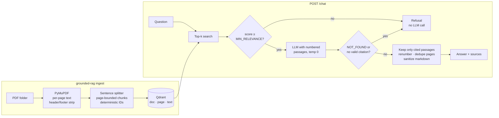

# Grounded RAG — a support chatbot that only answers from your PDFs

Ask a question, get a short answer **with the document name and page for every claim** — or an
honest *"I couldn't find this in our documents"* instead of a guess.

Built for the classic support-team problem: dozens of product guides, SOPs and FAQs, and the same
questions answered by hand every day.

- 📄 **Page-accurate citations** — passages never span pages, so "product-guide.pdf, page 4" is exact.
- 🛑 **Two-layer hallucination guard** — weak retrieval is refused *before* the LLM is called; the
  model must cite numbered passages, and answers without valid citations become refusals.
- 🔁 **Safe, idempotent ingestion** — re-run it any time; edited PDFs replace their old passages
  (new version is embedded *before* the old one is removed, so an API outage never empties a
  document), `--prune` drops PDFs you deleted. Scanned, encrypted or broken PDFs are reported.
- 📊 **Built-in evaluation** — refusal accuracy, correct-page hit rate, LLM-judged faithfulness and
  correctness, p95 latency → `report.md`.
- 🐳 **One command to run** — Qdrant + FastAPI + Streamlit via Docker Compose.
- ✅ **126 offline tests, 98% coverage** — no API key needed to run the suite (CI included).

The repo ships with four **synthetic** PDFs for a fictional company (Lumora Home Robotics, a robot
vacuum maker) and a 20-question eval set, so everything is runnable without real data.

## How it works



**Why two gates?** The retrieval threshold kills the cheapest, most common failure — off-topic
questions ("What's the CEO's salary?") — at zero LLM cost. The citation contract catches the subtler
one: questions that *look* related but aren't actually answered by the passages. Sources are built
from stored metadata, never from model text, so a citation can't point at a page that wasn't
retrieved.

## Quickstart (Docker)

```bash
cp .env.example .env              # then set OPENAI_API_KEY
docker compose up -d --build      # qdrant + api (:8000) + ui (:8501)
docker compose run --rm ingest    # loads data/sample_pdfs
```

Open **http://localhost:8501** and try *"How do I factory reset the S7?"* or *"Who is the CEO?"*.

To use your own documents, put PDFs in `data/pdfs/`, set `PDF_DIR=data/pdfs` in `.env`, and re-run
the ingest job (`docker compose run --rm ingest grounded-rag ingest --prune` also removes PDFs you
deleted from the folder).

## Local development (no Docker)

```bash
uv venv --python 3.12 && uv pip install -e ".[ui,dev]"
cp .env.example .env              # set OPENAI_API_KEY; QDRANT_PATH uses embedded Qdrant
grounded-rag ingest
grounded-rag ask "How long is the battery warranty?"
grounded-rag serve                                    # API on :8000
streamlit run src/grounded_rag/ui/streamlit_app.py    # UI on :8501
pytest --cov                                          # offline test suite
```

Embedded Qdrant (`QDRANT_PATH`) allows one process at a time; stop the API before running `ingest`,
or use the Docker setup.

## API

```bash
curl -s localhost:8000/chat -H 'content-type: application/json' \
  -d '{"question": "How do I factory reset the S7?"}'
```

```json
{
  "answer": "Hold the Home and Spot buttons together for 10 seconds until the light ring flashes blue [1].",
  "refused": false,
  "sources": [
    {"doc_name": "product-guide.pdf", "page": 4, "excerpt": "Factory reset: To restore factory settings, hold…", "score": 0.71}
  ]
}
```

| Endpoint | Purpose |
|---|---|
| `GET /health` | `{"status": "ok", "chunks": N}` |
| `POST /chat` | `{"question": "..."}` (1–2000 chars) → answer, `refused`, `sources` |

Refusals return `200` with `refused: true` and no sources. Upstream failures (OpenAI, Qdrant) return
`503` — never a made-up answer. Set `API_KEY` to require an `X-API-Key` header on `/chat`.
Interactive docs at `/docs`.

## Evaluation

```bash
grounded-rag eval                      # or: docker compose run --rm api grounded-rag eval
grounded-rag eval --no-judge           # skip LLM-judge scores (cheaper)
```

Writes `eval/results/report.md` and `report.json`:

| Metric | What it measures |
|---|---|
| Refusal accuracy | answered when the docs cover it, refused when they don't |
| Correct document + page cited | at least one expected `(doc, page)` among the sources |
| Faithfulness (0–1) | LLM judge: share of claims supported by the cited passages |
| Correctness (0–1) | LLM judge: agreement with the reference answer |
| p95 latency | end-to-end answer time |

The question format (`eval/questions.json`) supports `reference_answer`, `expected_sources` and
`"answerable": false` for questions the bot must refuse — see
[the contract](specs/001-grounded-docs-chatbot/contracts/eval-dataset.md).

> **Why not RAGAS?** The same two LLM-judged metrics are implemented in ~80 lines
> ([judge.py](src/grounded_rag/evaluation/judge.py)). At the time of writing, `ragas` 0.4.3 fails on
> import against current `langchain-community`, and a quality gate shouldn't depend on a fragile
> dependency chain.

### Tuning

| Symptom in the report | Knob |
|---|---|
| Unanswerable questions get answered | raise `MIN_RELEVANCE` (e.g. 0.30 → 0.40) |
| Answerable questions get refused | lower `MIN_RELEVANCE`, raise `TOP_K` |
| Right document, wrong page / partial answers | lower `CHUNK_SIZE` (512 → 256) |

Re-run `ingest` after changing chunking, then `eval` after any change.

## Configuration

All settings come from environment variables (see [.env.example](.env.example)), validated at
startup.

| Variable | Default | Notes |
|---|---|---|
| `OPENAI_API_KEY` | — | required (OpenAI or any OpenAI-compatible provider) |
| `OPENAI_BASE_URL` | — | e.g. `https://openrouter.ai/api/v1`; use `openai/…` model names there |
| `OPENAI_CHAT_MODEL` | `gpt-4.1-mini` | any OpenAI chat model |
| `OPENAI_EMBED_MODEL` | `text-embedding-3-small` | re-ingest after changing |
| `QDRANT_URL` / `QDRANT_PATH` | — / `.qdrant_local` | server vs embedded mode |
| `TOP_K` | `5` | passages retrieved |
| `MIN_RELEVANCE` | `0.30` | cosine similarity gate |
| `CHUNK_SIZE` / `CHUNK_OVERLAP` | `512` / `64` | tokens |
| `PDF_DIR` | `data/sample_pdfs` | ingest source |
| `API_KEY` | — | optional auth for `/chat` |

## Project layout

```text
src/grounded_rag/
├── ingest/        pdf_reader · chunker · pipeline
├── rag/           engine (grounding gates) · citations · prompts · sanitize
├── evaluation/    dataset · runner · judge · report
├── api/app.py     FastAPI
├── ui/            Streamlit chat page
├── store.py       Qdrant via LlamaIndex
├── factory.py     wires OpenAI + Qdrant from settings
└── cli.py         ingest | ask | eval | serve
specs/001-…/       spec-kit: spec, plan, research, data model, contracts, tasks
```

The project was built spec-first with [GitHub Spec Kit](https://github.com/github/spec-kit): the
[constitution](.specify/memory/constitution.md) fixes the non-negotiables (grounded-or-silent,
traceable claims, offline tests, measured quality), and every module traces back to a requirement in
[spec.md](specs/001-grounded-docs-chatbot/spec.md).

## Design decisions

- **Qdrant** over Pinecone/Chroma: one container next to the app, data stays in-house, clean
  delete-by-document; embedded mode for dev and tests. pgvector is a drop-in alternative behind
  `store.py` if Postgres already exists.
- **LlamaIndex for plumbing, custom engine for grounding**: the stock citation query engine doesn't
  validate citations or refuse deterministically; here both are explicit and unit-tested.
- **Per-page chunks** trade a little cross-page context for exact page citations — the thing support
  agents actually need to verify an answer.
- **Answers are treated as untrusted output.** Document text could carry prompt-injection payloads,
  so the API strips link destinations, reference definitions and HTML, the model is refused if it
  cites a passage number it was never given, and the UI renders through an allowlist escaper (only
  citation markers and bold survive) with source excerpts shown as plain text.

## Limitations and next steps

- Scanned PDFs are detected and reported but not OCR'd (add Docling/Tesseract for those).
- Single-turn Q&A; no conversation memory.
- Citations are enforced per answer, not per sentence: an answer with valid citations could still
  contain one uncited sentence. The eval's faithfulness score is the check for this.
- No user accounts or rate limiting. All ports bind to `127.0.0.1` by default; to share the chat
  page with a team, put it behind your SSO or an authenticating reverse proxy.
- Possible upgrades: hybrid (BM25 + vector) search for part numbers and error codes, a reranker,
  answer streaming.

## License

MIT
